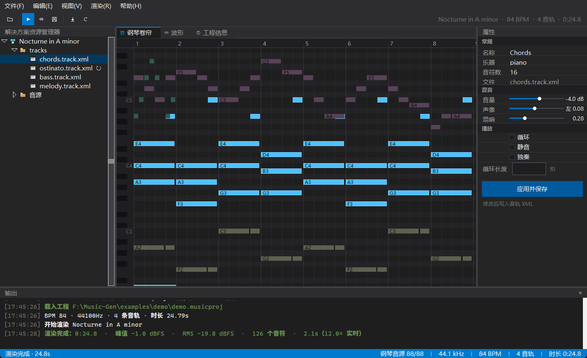

# MusicGen

用 `*.musicproj`（XML）工程文件渲染出乐器纯音乐 WAV。带命令行与桌面图形界面。



## 特性

- **工程即 XML**：一个 `*.musicproj` + 每条音轨一个 `*.track.xml`，可读、可手改、好做版本管理
- **按音轨控制**：乐器、速度（可逐轨覆盖）、音量、声像、混响、是否循环、循环长度/次数、移调
- **六种真实音色 + 鼓组**：钢琴 / 小提琴 / 大提琴 / 小号 / 竖笛 / 吉他，FluidR3 GM 逐音采样（开源），
  共 298 个采样；多镜像并发下载、本地缓存、逐件电平校准，缺采样时自动回退内置合成器
- **架子鼓不用下载**：内置合成鼓组，鼓谱直接写 `pitch="kick,snare"`、`pitch="hihat"`，
  GM 打击乐 35–82 全映射，力度控制音量与亮度
- **乐器随手换**：工程里写 `instrument="cello"` 或 `instrument="大提琴"` 都行，界面属性面板有下拉框
- **渲染质量**：力度→音量+亮度、松键释放、合成 IR 混响、等功率声像、峰值归一化、16/24/32bit 与 32bit float 输出
- **内置预览**：渲染完直接在应用里播放——播放/暂停、停止、拖动进度定位、音量，卷帘与波形上有播放头
- **新建工程向导**：名称/位置/速度/采样率/拍号/模板（示例 or 空白），创建即打开
- **逐个音符编辑**：卷帘里点中任意一小段，右下面板直接改起始/时长/音高/力度，还能复制、删除、逐个跳
- **可滚动的卷帘**：滚轮上下、`Alt+滚轮`左右、`Ctrl+滚轮`横向缩放、`Shift+滚轮`纵向缩放、中键拖动平移，带滚动条
- **可停靠的工作区**：资源管理器 / 属性 / 音符 / 输出按住标题栏拖到窗口边缘即可停靠到左、右、底部，
  也能关闭；分栏可拖拽，拖入第二个面板时自动撑大该区，布局自动记忆
- **两套入口**：`python -m musicgen render` 与桌面界面
- **Visual Studio 2022 风格界面**：深色工作区、解决方案资源管理器、文档标签页（钢琴卷帘 / 波形 / 工程信息）、
  属性窗口、音符窗口、输出窗口、蓝色状态栏；界面按面板拆成多个模块，加页面只需新增一个文件

## 快速开始

```bat
py -3 -m pip install -r requirements.txt   # numpy / soundfile / sounddevice
py -3 -m musicgen samples fetch                     # 下载全部音源（六件乐器，约 8MB）
py -3 -m musicgen render examples\twinkle\twinkle.musicproj -o twinkle.wav  # 《小星星》完整编曲
py -3 -m musicgen render examples\band\band.musicproj -o band.wav          # 竖笛 + 吉他 + 鼓
py -3 -m musicgen render examples\demo\demo.musicproj -o demo.wav
py -3 -m musicgen render examples\ensemble\ensemble.musicproj -o trio.wav   # 四重奏示例
py -3 -m musicgen gui examples\demo\demo.musicproj  # 或者双击 MusicGen.bat
```

当前机器上默认的 `python` 没有 tkinter，界面请用 `py -3`（3.14）。

## 工程文件示例

```xml
<!-- demo.musicproj -->
<musicproj name="Nocturne in A minor" bpm="84" sampleRate="44100" length="auto">
  <track file="tracks/chords.track.xml"/>
  <track file="tracks/ostinato.track.xml" gain="-4dB"/>
</musicproj>

<!-- tracks/violin.track.xml：instrument 可写 violin / cello / trumpet / piano / recorder / guitar / drums，也可写中文名 -->
<track name="Violin" instrument="violin" gain="-3dB" pan="0.22" reverb="0.35">
  <note time="0" dur="1" pitch="A4" vel="0.72"/>
</track>
```

```xml
<!-- tracks/ostinato.track.xml：4 拍一循环，平铺到整首 -->
<track name="Ostinato" instrument="piano" loop="true" loopLen="4"
       gain="-4dB" pan="-0.28" reverb="0.18">
  <note time="0"   dur="0.46" pitch="A4" vel="0.47"/>
  <note time="0.5" dur="0.46" pitch="C5" vel="0.42"/>
  <note time="1"   dur="0.46" pitch="E5" vel="0.42"/>
</track>
```

```xml
<!-- tracks/drums.track.xml：鼓件的名字直接当音高写，不用记 GM 编号 -->
<track name="Drums" instrument="drums" gain="0dB" reverb="0.12">
  <note time="0" dur="0.25" pitch="kick,hat"/>
  <note time="1" dur="0.25" pitch="snare"/>
  <note time="1.5" dur="0.25" pitch="openhat"/>
</track>
```

时值统一用「拍」，支持 `1/4` 与 `0.5` 两种写法；`pitch="C4,E4,G4"` 直接写和弦；
鼓件名 `kick` / `snare` / `hat` / `openhat` / `crash` / `tom1` / `floor` 见[项目文档 §8.4](docs/项目文档.md)。

## 命令

| 命令 | 作用 |
| --- | --- |
| `render <proj> [-o out.wav]` | 渲染 WAV（`--bits 16/24/32`、`--float32`、`--no-normalize`） |
| `validate <proj>` | 校验工程，列出全部错误与警告 |
| `info <proj>` | 工程概要 |
| `init <目录>` | 生成示例工程 |
| `samples fetch/list` | 下载/查看音源 |
| `gui [proj]` | 启动界面 |

完整参数表、真实输出、退出码与报错对照、批量脚本示例：[docs/CLI文档.md](docs/CLI文档.md)。

## 界面


一个主窗口，四个可拖动调整的区域：

- 顶部：菜单栏、命令条（新建/打开/应用/渲染/播放/停止/导出/音源/重载，按钮按状态自动置灰）、
  传输条（播放暂停/停止/进度/音量）
- 左：解决方案资源管理器（工程 → tracks → 音轨文件，右键静音/独奏）+ 音符面板
- 中：文档标签页——钢琴卷帘（钢琴键、小节网格、循环标记、双轴滚动与缩放）、波形、工程信息
- 右：属性（**乐器下拉框** + 采样状态、音量/声像/混响滑杆、循环、静音/独奏，应用后写回音轨 XML）
- 左下：音符（选中那一段的起始/时长/音高/力度，可复制、删除、跳相邻）
- 下：输出日志（分级着色），最底是 VS 蓝色状态栏

四个工具窗口都能换停靠位置：**按住标题栏拖到窗口左 / 右 / 下边缘**，蓝色高亮区出现后松手即可；
也可以点标题栏右上角的停靠按钮。窗口大小/停靠/分栏宽度会记在 `~/.musicgen/ui.json`。

卷帘操作：`滚轮` 上下 · `Alt+滚轮` 左右 · `Ctrl+滚轮` 缩放宽度 · `Shift+滚轮` 缩放行高 · 中键拖动平移；
单击音符选中（白色描边），`Delete` 删除、`Ctrl+D` 复制、`Ctrl+←/→` 切换音符。

## 文档与测试

- 格式规范、渲染管线细节、扩展新乐器的方法：[docs/项目文档.md](docs/项目文档.md)
- 命令行完整手册（每个参数、退出码、常见报错怎么办）：[docs/CLI文档.md](docs/CLI文档.md)
- 测试：`py -3 -m unittest discover -s tests -v`
