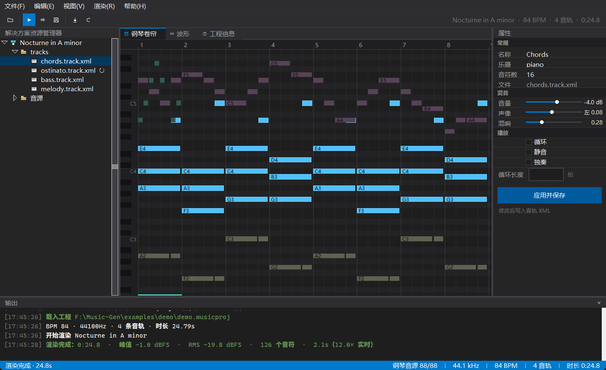
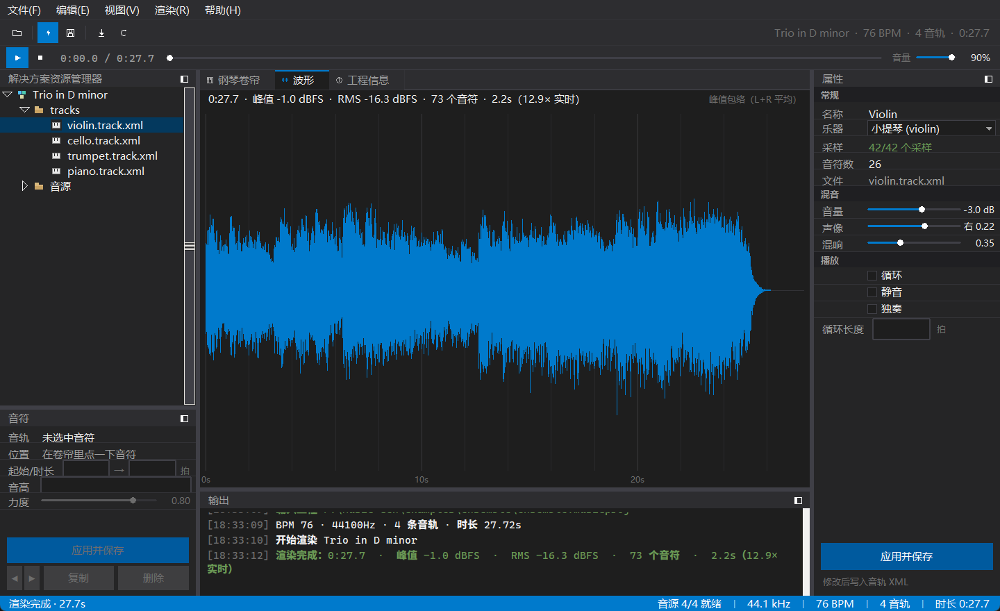
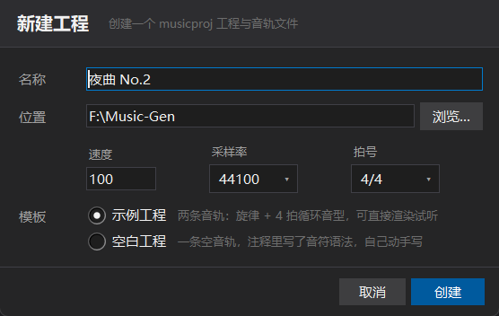

# MusicGen 项目文档

> 用 `*.musicproj`（XML）工程文件渲染出乐器纯音乐 WAV 的小型渲染器。含 CLI 与桌面 GUI。
> 文档与实现保持同步；改格式或改行为时请一并更新本文件。

---

## 1. 目标与设计原则

| 原则 | 落地方式 |
| --- | --- |
| 工程可读、可手改 | 工程与音轨都用 XML，属性用中文注释友好的名字，时值用「拍」而不是采样点 |
| 一个音轨一个文件 | 每个音轨独立 `*.track.xml`，便于版本管理与多人分工 |
| 结果确定性 | 混响脉冲响应用固定随机种子，同一工程多次渲染结果一致 |
| 零配置起步 | 音源缺失时自动回退内置合成器，`samples fetch` 一条命令补齐真实音色 |
| 尽量用标准接口 | 解析用 `xml.etree`、混音/FFT 用 numpy、解码用 `soundfile`（libsndfile）；只有 24bit/浮点 WAV 写出因标准库 `wave` 不支持而手写 RIFF 头 |

---

## 2. 环境与依赖

| 项 | 说明 |
| --- | --- |
| Python | 3.10+（本机 GUI 需用 `py -3`，即 3.14，系统默认的 3.13.12 未编译 tkinter） |
| numpy | 音频数组与 FFT |
| soundfile | 解码 mp3/ogg/flac/wav，写出校验（`wave` 模块不支持 24bit/float） |
| tkinter | 仅 GUI 需要，随 Python 官方安装包提供 |
| sounddevice | 仅内置预览需要（音频输出），缺失时自动退回系统播放器 |

安装（清华源不可用，见备注）：

```bat
py -3 -m pip install -r requirements.txt
py -3 -m pip install -r requirements.txt -i https://mirrors.aliyun.com/pypi/simple/
```

> 备注：本机实测 PyPI 清华源不存在对应 wheel，阿里云源与官方源正常（约 5MB/s）。

---

## 3. 目录结构

```
Music-Gen/
├─ MusicGen.bat            双击启动 GUI（无控制台窗口）
├─ MusicGen-CLI.bat        命令行包装（等价 python -m musicgen ...）
├─ requirements.txt
├─ musicgen/
│  ├─ __main__.py          python -m musicgen 入口
│  ├─ cli.py               argparse 子命令：render/validate/info/init/samples/gui
│  ├─ core/
│  │  ├─ notes.py          音名 ↔ MIDI ↔ 频率
│  │  ├─ project.py        musicproj / track.xml 解析、校验、回写
│  │  ├─ sampler.py        采样 → 变调 → 力度 → 包络 → 立体声片段
│  │  ├─ instruments.py    乐器注册表（采样乐器 / 内置合成器兜底）
│  │  ├─ render.py         循环展开、混音、混响、母带
│  │  └─ wavio.py          WAV 写出（16/24/32bit + 32bit float）
│  ├─ samples/fetch.py     开源音源多镜像并发下载与缓存
│  └─ gui/                 Tkinter 界面，按面板/页面拆成多个模块
│     ├─ app.py            主窗口：装配布局 + 业务调度（唯一有业务逻辑的界面文件）
│     ├─ theme.py          VS 2022 深色调色板、字体、ttk 样式、原生标题栏变暗
│     ├─ widgets.py        通用控件：工具按钮/面板标题/文档标签条/滑块/复选框/属性网格/日志
│     ├─ icons.py          图标：工具栏用 Canvas 矢量画，资源管理器用 PhotoImage 位图
│     ├─ menubar.py        自绘深色菜单栏（原生菜单条无法上色）
│     ├─ toolbar.py        命令条
│     ├─ tracklist.py      左：解决方案资源管理器
│     ├─ pianoroll.py      文档页：钢琴卷帘
│     ├─ waveform.py       文档页：波形
│     ├─ info.py           文档页：工程信息
│     ├─ properties.py     右：属性窗口
│     ├─ output.py         下：输出窗口
│     └─ statusbar.py      状态栏
├─ examples/demo/          示例工程（8 小节 a 小调钢琴小品）
├─ samples_cache/          音源缓存（不入库）
├─ docs/项目文档.md
└─ tests/                  test_core.py（单元）、test_gui.py（界面冒烟）
```

---

## 4. 快速开始

```bat
rem 1. 首次：下载钢琴音源（88 键，约 2.6MB，8 线程并发，十几秒）
py -3 -m musicgen samples fetch

rem 2. 渲染示例工程
py -3 -m musicgen render examples\demo\demo.musicproj -o out.wav

rem 3. 打开界面
py -3 -m musicgen gui examples\demo\demo.musicproj
```

---

## 5. 工程文件 `*.musicproj`

```xml
<?xml version="1.0" encoding="UTF-8"?>
<musicproj name="Nocturne in A minor" bpm="84" sampleRate="44100"
           beatsPerBar="4" length="auto" tail="2s"
           masterGain="-1dB" normalize="true">
  <track file="tracks/chords.track.xml"/>
  <track file="tracks/ostinato.track.xml" gain="-4dB"/>
</musicproj>
```

### 5.1 `<musicproj>` 属性

| 属性 | 默认 | 说明 |
| --- | --- | --- |
| `name` | 文件名 | 工程名，CLI/GUI 显示用 |
| `bpm` | 120 | 全局速度，范围 5–600；音轨可覆盖 |
| `sampleRate` | 44100 | 输出采样率，推荐 44100/48000 |
| `beatsPerBar` | 4 | 每小节拍数，用于小节网格与 `length="Nbar"` |
| `length` | auto | 见 §7.1 |
| `tail` | 2s | 仅 `length=auto` 生效：最后一个音之后多渲染的余韵；`0` 表示不附加 |
| `masterGain` | 0dB | 母带增益，`-3dB` / `+1.5dB` 均可 |
| `normalize` | true | 峰值归一到 −1dBFS；`false` 时仅做削波保护 |

### 5.2 `<track>` 引用

`file` 为相对工程目录的路径（必填）。工程层可覆盖音轨文件里的这些属性：
`name`、`gain`、`pan`、`mute`、`solo`、`loop`。

> GUI 里「应用并保存」会把参数写进音轨文件，并自动删除工程层对同一音轨的覆盖属性，
> 避免下次载入被旧值盖回去。

---

## 6. 音轨文件 `*.track.xml`

```xml
<?xml version="1.0" encoding="UTF-8"?>
<track name="Melody" instrument="piano" gain="-3dB" pan="0.16"
       reverb="0.32" bpm="84" transpose="0">
  <note time="0"   dur="0.5" pitch="E5"        vel="0.78"/>
  <note time="0.5" dur="0.5" pitch="G5"        vel="0.70"/>
  <note time="1"   dur="1"   pitch="C6,E5,G5"  vel="0.72"/>
  <note dur="1"    pitch="B5"                   vel="0.66"/>  <!-- 省略 time = 接上一个音结尾 -->
</track>
```

### 6.1 `<track>` 属性

| 属性 | 默认 | 说明 |
| --- | --- | --- |
| `name` | 文件名 | 音轨名 |
| `instrument` | piano | 乐器键名，见 §8；未注册则回退合成器并告警 |
| `bpm` | 跟随工程 | 本轨速度；音符时值按本轨 BPM 换算成秒 |
| `gain` | 0dB | 轨道音量 |
| `pan` | 0 | −1 全左 … +1 全右（等功率声像） |
| `reverb` | 0 | 0–1，混响发送量 |
| `loop` | false | 见 §7.2 |
| `loopLen` | 自动 | 循环周期（拍）；不给则向上取整到整小节 |
| `loopCount` | 0 | 循环次数；0 = 一直循环到工程结束 |
| `mute` / `solo` | false | 静音 / 独奏（有独奏时只渲染独奏轨） |
| `transpose` | 0 | 整体移调半音数，直接作用在音高上 |

### 6.2 `<note>` 属性

| 属性 | 必填 | 说明 |
| --- | --- | --- |
| `time` | 否 | 起始位置（拍，从 0 开始）；省略时接在上一个音的结尾 |
| `dur` | 是 | 时值（拍），必须 > 0 |
| `pitch` | 是 | 音名，多个用逗号分隔即和弦：`C4,E4,G4`；也接受 `#`/`b`/`♯`/`♭` 与纯数字 MIDI（`60`） |
| `vel` | 否 | 力度：0–1 小数，或 1–127 整数（自动归一化），默认 0.8 |

音名用科学音高记法，`C4` = 中央 C = MIDI 60。

### 6.3 时值写法

`time` / `dur` / `loopLen` / `length` 统一支持：

| 写法 | 含义 |
| --- | --- |
| `1/4` | 四分之一拍（分数写法） |
| `0.5` | 半拍（小数） |
| `2*4` | 8 拍（连乘，便于写「两小节」） |

---

## 7. 时间、时长与循环

### 7.1 总时长

* `length="32"` → 32 拍；`length="8s"` / `"500ms"` / `"4bar"` 亦可。
* `length="auto"`（默认）→ 取**所有非无限循环轨**中最晚的结束时间，再加 `tail`。
  若全部是无限循环轨，则按 4 小节 + `tail` 计算。

### 7.2 循环语义

```
周期 period = loopLen（若给出）
             = ceil(内容长度 / beatsPerBar) * beatsPerBar（否则，至少 1 小节）
时间段 = [k*period, (k+1)*period)   k = 0,1,2,…
```

* `loopCount=0`：一直重复到工程时长结束；`loopCount=N`：只重复 N 次。
* 音符起点 ≥ `period` 时不会被播放，解析阶段给出警告。
* 音符**可以**越过周期边界继续发声（钢琴延音本来就该这样），不做切断。
* 循环轨在每个重复点只是「重新触发同样的音符」，不做时间拉伸。

---

## 8. 乐器与音源

### 8.1 已支持

| 键名 | 音源 | 音域 | 许可 |
| --- | --- | --- | --- |
| `piano` | FluidR3 GM — Acoustic Grand Piano（逐键 MP3） | A0–C8（88 键） | 自由使用 / MIT（源自 Frank Wen 的 FluidR3 GM） |

下载镜像按顺序尝试，每个文件 20s 超时后自动换下一个，整体 300s 预算：

1. `cdn.jsdelivr.net`
2. `fastly.jsdelivr.net`
3. `raw.githubusercontent.com`
4. `gcore.jsdelivr.net`

缓存目录 `samples_cache/<乐器>/`，附带 `manifest.json`（来源、许可、文件清单、更新时间）。
缓存目录可用 `--cache-dir` 或环境变量 `MUSICGEN_SAMPLES` 改变。

> 备选源（体积大、境内访问慢，暂未启用）：Salamander Grand Piano（CC-BY 3.0，约 1GB）、
> University of Iowa Musical Instrument Samples。archive.org 在本机实测超时，已排除。

### 8.2 新增一个乐器

1. 在 `musicgen/samples/fetch.py` 里加一个 `InstrumentSource`（URL 模板里用 `{name}` `{ext}`）并注册进 `SOURCES`；
2. 若播放模型与采样钢琴一致，不需要改 `instruments.py`，`instrument="新键名"` 即可；
3. 若需要不同合成方式，在 `core/instruments.py` 的 `InstrumentRegistry.get()` 里分支返回自定义对象，
   只要实现 `render_note(midi, velocity, duration) -> (2, N) float32` 即可。

### 8.3 兜底

未注册乐器 / 采样未下载 / 单个采样损坏 → 用 `SynthInstrument`（8 次谐波加性合成 + 指数衰减），
并在 CLI 警告或 GUI 状态栏提示，**渲染不会失败**。

---

## 9. 渲染管线

```
解析工程 → 展开循环 → 逐音符取采样 → 变调/力度/包络 → 轨道处理(增益·混响·声像)
        → 总线求和 → 母带(增益·归一化·削波保护) → WAV 写出
```

| 环节 | 实现 |
| --- | --- |
| 采样选择 | 取最近的已缓存音高；完全覆盖 88 键时无需变调 |
| 变调 | 线性插值重采样，倍率 `2^(半音/12)` |
| 力度 | 音量 `vel^1.4`；亮度随力度变化（一阶 FIR 低通，截止 4kHz→18kHz） |
| 起音 | 2ms 淡入消除爆音 |
| 释放 | 松键后 0.35s 曲线淡出（指数 1.6）；采样被截断时末尾 0.15s 淡出 |
| 复用 | 同乐器同音高同力度同时值的片段只渲染一次，循环轨大量复用 |
| 混响 | 合成脉冲响应（0.55–2.45s 指数衰减噪声、预延迟 15ms、立体声去相关）+ FFT 卷积，湿声 = 干声 × `reverb` × 0.9 |
| 声像 | 等功率：`L=cos θ, R=sin θ, θ=(pan+1)·π/4` |
| 母带 | `masterGain` → 峰值归一化到 −1dBFS → 必要时硬削波保护 |
| 量化 | 16/24/32bit 整数加 TPDF 抖动；32bit float 不抖动 |

性能参考（i5 级 CPU，单线程）：24.8 秒的示例工程约 2.2 秒渲染完（约 11× 实时）。

---

## 10. CLI 参考

```
python -m musicgen <命令> [参数]
```

| 命令 | 说明 |
| --- | --- |
| `render <proj> [-o out.wav] [--bits 16/24/32] [--float32] [--no-normalize] [--no-dither] [--quiet] [--cache-dir DIR]` | 渲染为 WAV；默认输出同名 `.wav`，24bit |
| `validate <proj>` | 只校验，打印全部错误与警告 |
| `info <proj>` | 打印工程概要（BPM、时长、每轨参数） |
| `init <目录> [--name N] [--force]` | 生成含两条音轨的示例工程 |
| `samples fetch [--instrument piano] [--force] [--cache-dir DIR]` | 下载音源 |
| `samples list` | 查看音源缓存状态 |
| `gui [proj]` | 启动图形界面 |

退出码：`0` 成功，`1` 参数/下载错误，`2` 工程文件有错，`3` 渲染失败。

---

## 11. GUI 使用

界面复刻 Visual Studio 2022 深色工作区：菜单栏 + 命令条 + 传输条 + 左中右三栏 + 底部输出 + 蓝色状态栏。
三栏之间、编辑区与输出之间都是可拖动的分隔条（`tk.PanedWindow`），面板还能换停靠位置或关掉，
窗口大小、停靠位置、分栏宽度、当前页面都会记住。





| 区域 | 操作 |
| --- | --- |
| 菜单栏 | 文件（新建/打开/应用参数/导出）、编辑（静音/独奏/清空输出）、视图（文档页/工具窗口/停靠/重置布局）、渲染（渲染/预览/停止/音源/重载）、帮助 |
| 命令条 | 打开工程、渲染（⚡）、导出 WAV、下载音源、重新载入；右侧显示工程摘要 |
| 传输条 | ▶/⏸ 播放暂停、■ 停止、时间、可拖动进度条、音量；没有渲染结果时整体置灰 |
| 左：解决方案资源管理器 | 树形列出工程 → tracks → 各音轨文件；选中即切换当前音轨；右键可静音/独奏；`↻` 表示循环轨，静音行变灰 |
| 中：文档区 | 三个标签页：**钢琴卷帘**（默认）、**波形**、**工程信息**；`Ctrl+1/2/3` 切换 |
| 钢琴卷帘 | 左侧画钢琴键与 C 音名；横轴小节号+拍线；滚轮平移、`Ctrl+滚轮`以鼠标为中心缩放、点标尺复位；鼠标悬停显示小节/拍位置；点击音符跳到该音轨；循环轨底部有色条标出循环周期 |
| 波形 | 渲染完成后自动切到这里，显示峰值包络、时间轴与统计（时长/峰值/RMS/音符数/倍速） |
| 工程信息 | 只读文本：全局参数、每轨参数表、警告 |
| 右：属性 | 常规（名称/乐器/音符数/文件）、混音（音量/声像/混响 滑杆）、播放（循环/静音/独奏/循环长度）；「应用并保存」写回音轨 XML 并清除工程层覆盖 |
| 底部：输出 | 时间戳 + 分级着色的日志（载入、渲染进度、导出、错误） |
| 状态栏 | 左侧消息与细进度条（空闲自动隐藏），右侧指标：音源状态 / 采样率 / BPM / 音轨数 / 时长 |

快捷键：`Ctrl+N` 新建、`Ctrl+O` 打开、`Ctrl+R` 渲染、`Ctrl+S` 导出、`Ctrl+Enter` 应用参数、
`F5` 重载、`空格` 播放/暂停、`Esc` 停止、`Ctrl+1/2/3` 切文档页、
`Ctrl+Shift+E` 开关资源管理器、`F4` 开关属性、`Ctrl+L` 开关输出、`M`/`S` 静音/独奏。

渲染与音源下载都在后台线程，进度经队列回传主线程，界面不会卡死。

> 视觉细节：原生 Windows 标题栏通过 `DwmSetWindowAttribute` 变暗；原生菜单条在 Windows 上
> 无法上色，因此菜单栏是自绘的一排 `Menubutton`，下拉仍是可上色的 `tk.Menu`。

### 11.1 界面模块划分

| 文件 | 职责 |
| --- | --- |
| `app.py` | 唯一知道业务的地方：装配各 view、菜单/快捷键、打开/渲染/导出/下载、线程与队列 |
| `theme.py` | 调色板 `PALETTE`、字体、ttk 样式、深色标题栏；改主题只改这一个文件 |
| `widgets.py` | 无业务的可复用控件：`ToolButton` `PanelHeader` `TabStrip` `MiniSlider` `CheckBox` `PropertyGrid` `LogView` `Tooltip` |
| `icons.py` | `draw()` 在 Canvas 上矢量画图标；`image()` 生成 Treeview 用的 16×16 位图 |
| `transport.py` | 传输条：`SeekBar`（可拖动进度）+ 播放/停止/时间/音量 |
| `player.py` | 内置播放器：`sounddevice` 输出、播放/暂停/定位、按设备采样率重采样 |
| `docking.py` | 停靠管理：三个停靠区、面板重建、停靠菜单、分栏尺寸记忆 |
| `newproject.py` | 新建工程对话框 |
| `layout.py` | 布局读写（`~/.musicgen/ui.json`） |
| `tracklist/pianoroll/waveform/info/properties/output/statusbar/toolbar/menubar` | 每个面板/页面一个模块，只负责自己的渲染与事件，通过回调向 `app` 汇报 |

新增一个文档页：在 `gui/` 下写一个 `tk.Frame` 子类，实现 `pack` 用的内容与一个重绘方法，
然后在 `app.PAGES` 里注册 `(key, 标题, 图标)` 并 `self.pages[key] = 实例`。
新增一个工具窗口：写一个带 `.header`（`PanelHeader`）的 `tk.Frame`，在 `app._build_docks()`
的 `factories`/`titles`/`defaults` 里各加一项即可，停靠菜单与布局记忆会自动接管。

### 11.2 新建工程

`Ctrl+N` 或「文件 → 新建工程…」打开对话框：

| 项 | 说明 |
| --- | --- |
| 名称 | 工程名，同时作为子目录名（在「位置」下创建同名目录） |
| 位置 | 工程存放的父目录，可直接输入或点「浏览…」 |
| 速度 / 采样率 / 拍号 | 写入 `musicproj` 的 `bpm` / `sampleRate` / `beatsPerBar` |
| 模板 | **示例工程**：两条音轨（旋律 + 4 拍循环音型）；**空白工程**：一条空音轨，注释里写了音符语法 |



同名工程已存在时会询问是否覆盖。创建完自动打开。
同样的能力在命令行上是 `python -m musicgen init <目录> --bpm 96 --template empty`。

### 11.3 预览播放

渲染完成后传输条自动启用，声音直接由内置播放器（`sounddevice` / PortAudio）送到声卡：

* **播放/暂停**：`空格` 或传输条按钮；暂停保留播放位置。
* **停止**：`Esc`，回到 0。
* **定位**：拖动进度条松手即跳转，播放中跳转会从新位置继续。
* **音量**：传输条右侧，0–100%，只影响预览，不影响导出文件。
* **播放头**：钢琴卷帘与波形上会画一条白色竖线，跟随播放位置移动（只重画那一条线，不整体重绘）。

采样率与声卡不一致时会在载入时重采样一次；声卡被占用或没有输出设备时，
自动退回「用系统播放器打开临时 WAV」，并在输出窗口提示原因。

### 11.4 停靠与布局

* 三个工具窗口（解决方案资源管理器 / 属性 / 输出）都能停在 **左侧 / 右侧 / 底部**，
  用面板标题栏右上角的「停靠」按钮（或「视图 → 停靠到」）切换；停靠区空了会自动收起。
* 面板右上角的停靠菜单里还有「关闭」；关掉后可从「视图」菜单的勾选项重新打开。
* 「视图 → 重置布局」一键回到默认布局。
* 面板之间的分隔条可以拖动改大小（6px 宽，鼠标移上去会变成双向箭头）；
  同一个停靠区里堆了两个面板（比如资源管理器 + 属性都在左侧）时，它们之间也有分隔条。
* 窗口大小、停靠位置、所有分栏位置、当前文档页、音量都存到 `~/.musicgen/ui.json`，下次启动自动恢复。

> 实现要点：Tk 控件不能换父容器，所以停靠的做法是**销毁并在新容器里重建**面板，
> 重建时由 `app._on_panel_created()` 把状态（当前音轨、日志内容、音频结果）灌回去。
> 布局文件位置可用环境变量 `MUSICGEN_UI` 覆盖（测试里就是这么做的）。

---

## 12. 测试

```bat
py -3 -m unittest discover -s tests -v
```

* `tests/test_core.py`：音名解析、时值解析、工程载入/校验/回写、渲染（音高 FFT 验证、
  循环次数、静音、兜底乐器、归一化）、WAV 三种位深。
* `tests/test_gui.py`：需要桌面环境，覆盖打开工程、新建工程对话框、文档页切换、卷帘绘制、
  选中音轨、静音切换、参数保存回写、面板停靠/开关、布局保存、后台渲染出波形，
  以及传输条播放/暂停/定位（无声卡时跳过）；无 tkinter 时自动跳过。

---

## 13. 已知限制与后续计划

1. **单一力度层**：FluidR3 每键只有一个采样，力度靠包络与低通模拟，强弱对比不如多层采样。
2. **采样长度固定 3.13s**：超长音符的尾音会被截断（末尾有 0.15s 淡出）。
3. **GUI 不能编辑音符**：只能在卷帘中查看，音符要通过 XML 编辑；后续可加拖拽/输入。
4. **播放依赖系统播放器**：没有内置实时音频输出（避免引入额外依赖）。
5. **不支持**：延音踏板、速度渐变（tempo map）、多力度层、效果链、MIDI 导入导出。
6. **只有钢琴音源**：其它乐器暂走合成器兜底，接口已预留（§8.2）。

---

## 14. 变更记录

| 日期 | 内容 |
| --- | --- |
| 2026-11-07 | v1.2：新增「新建工程」对话框（名称/位置/速度/采样率/拍号/模板）、内置预览播放器与传输条（播放/暂停/停止/拖动定位/音量/播放头）、面板停靠（左/右/底）与布局记忆（`~/.musicgen/ui.json`） |
| 2026-11-07 | v1.1：界面改为 Visual Studio 2022 深色风格，GUI 拆分为 13 个模块（app/theme/widgets/icons/9 个面板与页面），新增文档标签页、自绘菜单栏、属性滑杆与输出窗口 |
| 2026-11-07 | v1.0：XML 工程格式、钢琴音源下载、采样渲染与混响、WAV 写出、CLI 六个子命令、Tkinter GUI、27 个单元测试 + 6 个界面测试 |
